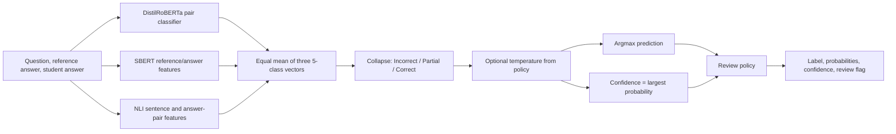

# Q&A architecture (source trace)

## Input and prediction flow

`A_predict.predict(question, reference_answer, student_answer,
dataset="pooled")` delegates to `predict_batch` in the frozen
`src/A_predict.py` copy. It returns a label, three-class probabilities,
confidence, review status, and NLI display evidence.

## Code locations

All line numbers below refer to `src/A_predict.py`, copied from
`project_s_qa/A_submission_v2/demo/A_predict.py`.

- Root and artifact locations: lines 8–11.
- Five-class order: lines 13–15: `correct`, `contradictory`,
  `partially_correct_incomplete`, `irrelevant`, `non_domain`.
- Five-to-three mapping: lines 56–57. Three-class order is Incorrect,
  Partial, Correct. Five-class indices 1, 3, 4 sum to Incorrect; index 2 is
  Partial; index 0 is Correct.
- DistilRoBERTa input: lines 61–75. First sequence is question + `" | "` +
  reference answer; second sequence is student answer. Tokenizer truncates at
  length 160.
- NLI input: lines 79–89. It receives student/reference sentence pairs and
  an answer/reference pair; it does not receive question text. Maximum token
  length is 192.
- SBERT input/features: lines 92–101. It embeds reference and student answer,
  then uses cosine, length ratio, and embedding combinations. No question text.
- Component outputs and pooled LR loading: lines 104–136. The public
  `component_probs` returns `ft`, `sb`, `nl`, `feats`, and `concepts`.
- Policy loading and final decision: lines 139–173. Component probabilities
  are equally averaged; `_to3` collapses the five classes; optional temperature
  is applied; argmax selects the label; max probability is confidence.
- Review reasons: lines 160–165. Low-confidence review is policy-controlled.
  The separate contradiction review can be enabled by policy, but the
  packaged policy copy says it is disabled. Missing policy falls back to a
  provisional threshold, so the actual runtime path must be checked.

## Rubrics, relevance and Partial

`A_predict.py` does not read a rubric file, question ID, required concepts,
accepted variants, or misconception list. `_concepts` at lines 43–45 splits
the provided reference answer into sentences for NLI evidence; it does not
load the new `question_bank/rubrics.json`. There is no separate relevance or
on-topic classifier. “Partial” is a learned class probability, not a concept
count. Off-topic answers can therefore receive Correct if the ensemble's
probability argmax says Correct; there is no independent relevance veto.

Block 64's new wrapper retrieves the linked rubric to display provenance and
review status, but explicitly sets `rubric_used_for_score` false and passes
only text fields to the frozen scorer. It does not change the model or policy.

## Artifact map

| Role | Current local path | Handover path |
|---|---|---|
| Deployed scorer | `project_s_qa/A_submission_v2/demo/A_predict.py` | `src/A_predict.py` |
| Policy / contract / scorer metadata / reference output | `project_s_qa/A_submission_v2/reports_v2/` | `src/config/` copies |
| Fine-tuned checkpoint | `project_s_qa/interim/ft_distilroberta_v1/` | Not copied; see `models/CHECKPOINT_ACCESS.md` |
| LR artifacts | `project_s_qa/interim/pooled_lr_v2.joblib`, `combiner_v1.joblib` | Not copied; see checkpoint/access note |
| Demo CSV | `project_s_qa/processed/cbse_demo_questions_v1.csv` | `question_bank/cbse_demo_questions_v1_source.csv` |
| New draft bank | Not previously present as linked JSON bank | `question_bank/questions.json`, `rubrics.json`, `schema.json` |

The caller loads `A_predict.py` from the actual Drive project's `reports_v2/`
folder. The files under this handover's `src/config/` are traceability copies,
not proof that the live Drive folder contains them.
