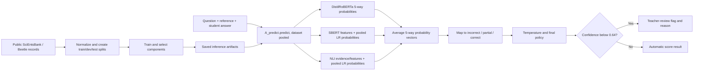
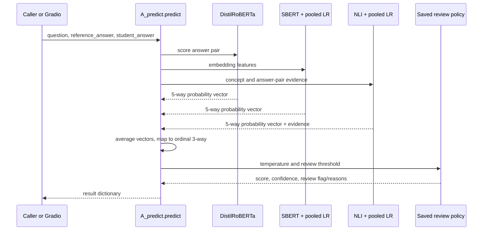
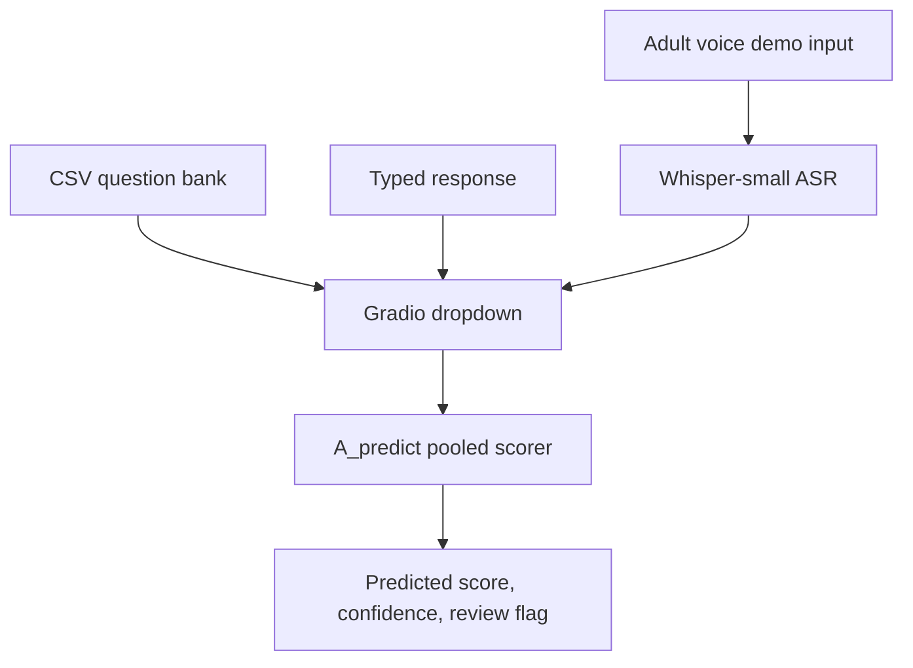

# Project S Q&A Architecture

## Scope
This diagram covers the implemented Q&A scorer and its Colab demo. It does not imply that the broader reading-assessment branch, child-profile fusion, or a production service is implemented.

## End-to-end data flow

## Component interactions

1. **Fine-tuned DistilRoBERTa** reads question/reference context with the student answer and returns probabilities in the five-label order documented in the notebook.
2. **SBERT + Logistic Regression** uses embedding-derived reference/answer features. In deployed pooled mode, the logistic-regression artifact comes from `pooled_lr_v2.joblib`.
3. **NLI + Logistic Regression** uses DeBERTa NLI outputs for concept-level and answer-pair evidence. Aggregated NLI features feed the pooled logistic-regression component.
4. `A_predict.component_probs` produces component probabilities. `predict_batch` averages the three component vectors, maps them into the three-level score space, applies the saved temperature, then computes review reasons.

The older `combiner_v1.joblib` is associated with the earlier stacking experiment; it is not an additional deployed probability component. Block 17's LLM experiment is not called by deployed inference.

## Inference and review flow

The `confidence` field is the maximum post-temperature probability across the three ordinal classes. It is not a correctness guarantee. The archived final policy has threshold 0.64 and disables the separate contradiction flag; missing policy can cause A_predict to use its provisional fallback.

## Demo architecture

Block 60 reads `processed/cbse_demo_questions_v1.csv` and requires `question_id`, `question_text`, and `reference_answer`. Voice transcription is a demo path, not evidence of child-voice performance. Gradio share URLs are temporary; no permanent deployment is verified.

## Artifact boundaries
- Scorer/reference pair: `reports_v2/A_predict.py`, `reports_v2/A_demo_reference_outputs_v2.json`.
- Fine-tuned weights/tokenizer: `interim/ft_distilroberta_v1/`.
- Logistic regressors: `interim/pooled_lr_v2.joblib`, plus the legacy `interim/combiner_v1.joblib` for its earlier experiment.
- Final deployed mode and review behavior: `reports_v2/A_deployed_scorer_v2.json`, `reports_v2/A_abstain_policy_v2.json`.
- CBSE demo input: `processed/cbse_demo_questions_v1.csv`.

Local Phase 4 evidence confirms the scorer hash matches the reference JSON and staged artifact hashes match the local staging manifest. Local filesystem evidence does not establish cloud synchronization.
