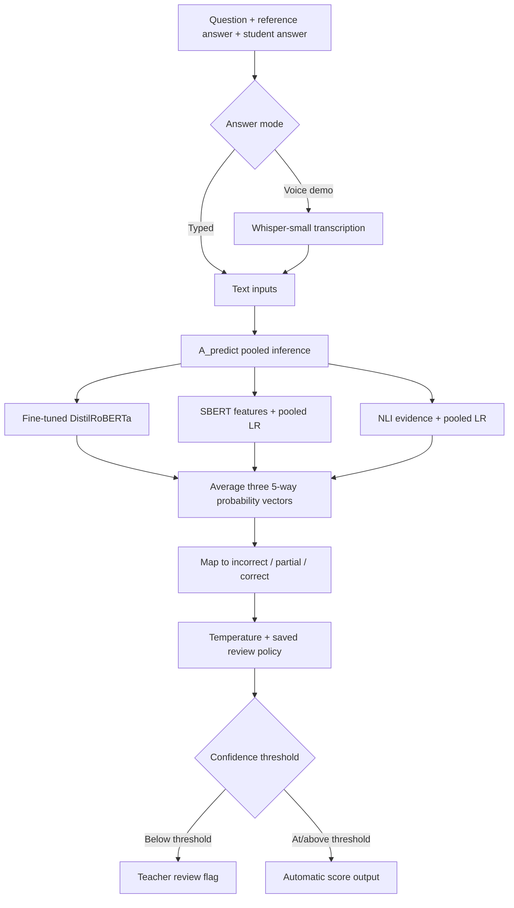

# Project S: Q&A Branch — Master Documentation

**Status:** Phase 4 freeze is PASS WITH LIMITATIONS; Phase 5 documentation is complete. The Q&A scorer was evaluated on public English science-answer datasets. It is not validated on CBSE data or Indian schoolchildren. This document describes the Q&A branch only; the wider oral-reading assessment and child-profile fusion remain separate project work.

## 1. Project Overview
Project S is a broader child reading and comprehension assessment project. This branch scores a typed or transcribed student answer against a question and reference answer. The current deployed Q&A scorer is a pooled probability-level ensemble of fine-tuned DistilRoBERTa, SBERT + Logistic Regression, and NLI + Logistic Regression. It uses no hosted LLM or external inference API.

## 2. Problem Statement
Given a science question, its reference answer, and a student's response, estimate whether the response is correct, contradictory, partially correct, irrelevant, or outside the domain. The deployed interface maps these five labels to an ordinal three-level result: incorrect (0), partial (1), or correct (2). Low-confidence cases can be flagged for teacher review.

## 3. Motivation and Objectives
Exact string matching misses answers that express the same idea with different words. The branch therefore compares semantic and entailment evidence as well as learned answer patterns. Its practical objective is to provide a score and review signal that a teacher can inspect. The required 85% accuracy at 30% coverage target has not been achieved; improvement is future model-development work, not a result of this documentation phase.

## 4. Research Background
The project design separates oral-reading performance from question-answer comprehension: reading a passage aloud does not by itself demonstrate understanding. The existing Notion master pages contain a broader literature review and proposed reading-system design. Their external paper claims were not independently rechecked for this documentation package. No literature-derived performance expectation is presented here as a result on this project.

## 5. Dataset Description
The measured Q&A work uses public English science short-answer data from SciEntsBank and Beetle. The source labels are the five classes listed in Section 7. The demo CSV contains 12 draft CBSE-style questions; it is a user-interface input, not training data and not a validated CBSE evaluation set. There is no validated Indian schoolchildren dataset in the evidence reviewed here.

## 6. Data Preparation and Preprocessing
The split pipeline lowercases student answers, collapses whitespace, and trims text for answer grouping. It preserves the official test splits. With seed 42, it holds out 15% of training questions as `dev_uq`; all answers for those questions stay in that split. It then moves 10% of remaining `(question_id, normalized_answer)` groups to `dev_ua`, keeping identical normalized answers together. A student key is derived as a best-effort identifier. These controls reduce leakage within the constructed splits; they do not establish performance on schools or populations outside the source datasets.

## 7. Label Mapping and Assessment Framework
Five-label order used by the scorer:

1. `correct`
2. `contradictory`
3. `partially_correct_incomplete`
4. `irrelevant`
5. `non_domain`

The official three-way mapping keeps `correct` and `contradictory` separate and maps partial, irrelevant, and non-domain responses to `incorrect`. The project's ordinal mapping maps contradictory, irrelevant, and non-domain to `incorrect`; partial to `partial`; and correct to `correct`, with scores 0, 1, and 2. QWK in the reported results is on this three-level mapping; macro-F1 is on the five labels unless stated otherwise.

## 8. System Architecture

The diagram describes implemented Q&A components and the Block 60 demo. Integration into a complete reading skill profile is not established by this branch.

## 9. Model Architecture
- **Fine-tuned DistilRoBERTa:** five-label classifier using question/reference context and a student answer. Training uses training rows; dev data is used for model selection. The saved checkpoint is under `interim/ft_distilroberta_v1/`.
- **SBERT + Logistic Regression:** semantic embedding-derived features compare the reference and student answer; a logistic-regression model produces five-label probabilities.
- **NLI + Logistic Regression:** a DeBERTa NLI cross-encoder provides entailment, contradiction, and neutral evidence for reference concepts and answer pairs. Aggregated features feed logistic regression.

The NLI and SBERT model identifiers are `cross-encoder/nli-deberta-v3-base` and `sentence-transformers/all-MiniLM-L6-v2`. No unsupported claim that one component is superior is made here.

## 10. Ensemble Methodology
In deployed `pooled` mode, `A_predict.py` obtains one five-class probability vector from each component, averages the vectors, maps them to the ordinal three-class space, applies the saved temperature, then applies the saved review policy. `pooled_lr_v2.joblib` contains pooled SBERT/NLI regressors. `combiner_v1.joblib` is a prior stacking artifact, not a fourth deployed component. The LLM side experiment in Block 17 is not part of deployed inference.

## 11. Training and Evaluation Methodology
The notebook contains historical baseline, NLI, fine-tuning, stacking, calibration, bootstrap, test, and demo blocks. Model selection and review-threshold decisions use development data. Seen-answer and unseen-question results are separated. Confidence intervals are generated with question-level paired bootstrap resampling. The grouped-CV estimate is a policy estimate, not a held-out test result. Test sets were seen in v1 and must remain labelled exploratory. Existing producer cells can overwrite frozen files; do not run the notebook end to end.

## 12. Experimental Results
Sources: archived `A_deployed_metrics_ci_v2.csv`, `A_test_results_v2.csv`, `A_abstain_policy_v2.json`, and saved Block 58 output. Dev results are optimistic; test results are exploratory.

| Result | Value | Context |
| --- | --- | --- |
| Dev overall QWK | 0.432 (95% CI 0.358-0.509) | Three-level ordinal score; dev, optimistic |
| Dev overall macro-F1 | 0.579 (95% CI 0.523-0.629) | Five labels; dev, optimistic |
| Seen-answer QWK | 0.630 (95% CI 0.562-0.692) | `dev_ua`; dev, optimistic |
| Seen-answer macro-F1 | 0.730 (95% CI 0.689-0.766) | Five labels; dev, optimistic |
| Unseen-question QWK | 0.317 (95% CI 0.199-0.412) | `dev_uq`, 27 questions; dev, optimistic |
| Unseen-question macro-F1 | 0.490 (95% CI 0.406-0.544) | Five labels; dev, optimistic |
| Grouped-CV estimate | 74.77% accuracy at 31.33% coverage | Policy estimate; not test performance |
| Exploratory test QWK | 0.454 (95% CI 0.392-0.515) | Test sets seen in v1 |
| Exploratory test macro-F1 | 0.576 (95% CI 0.543-0.606) | Five labels; test seen in v1 |
| Exploratory test 3-way accuracy | 0.588 | Test seen in v1 |
| Test coverage / auto-scored accuracy | 0.288 / 0.790 (95% CI 0.747-0.834) | Review threshold 0.64; test seen in v1 |

The development policy output reports 0.7512 auto-scored accuracy at 0.306 coverage. The target of 85% accuracy at 30% coverage was **NOT met**.

## 13. Inference Pipeline
`A_predict.predict(question, reference_answer, student_answer, dataset="pooled")` returns the predicted label and ordinal score, confidence, class probabilities, NLI/concept evidence, dataset/model information, and review reasons. The model path defaults to `/content/drive/MyDrive/project_s_qa`; `PROJECT_S_ROOT` can override it.

## 14. Confidence and Teacher Review
Confidence is the maximum final three-class probability after temperature transformation. It is a model confidence score, not a guarantee or directly observed probability of correctness. The saved final policy uses threshold 0.64 and disables the separate NLI contradiction flag. A missing policy can trigger a provisional fallback, so check the final policy file before interpreting review decisions.

## 15. Demo and Deployment
Block 45 compares 15 stored reference cases; the saved output and Jigar's report state 15/15 parity, matching predictions/review flags, and confidence differences within 0.001. This establishes implementation consistency on those cases, not accuracy or generalization. Block 60 uses a Gradio question dropdown backed by `processed/cbse_demo_questions_v1.csv`, requiring `question_id`, `question_text`, and `reference_answer`, and offers typed/voice input with Whisper-small. The share link is temporary. No permanent deployment or validated live pilot is established.

## 16. Limitations
- The 85% accuracy at 30% coverage requirement was not achieved.
- Unseen-question QWK (0.317 over 27 questions) is materially lower than seen-answer QWK (0.630).
- Block 51 reports exact negation performance of 3/12 with all 12 flagged for review. Separately, Block 61's 12/12 fine-tuned result and NLI contradiction probabilities around 0.507 are user-reported, with no local output; the diagnostics are not combined.
- Saved NLI evidence has entailment 0.87-0.96 for three of four unrelated examples; this does not explain off-topic answers reliably.
- Test sets were seen in v1, making test results exploratory.
- No CBSE/NCERT or Indian schoolchildren evaluation and no pilot student-answer validation are available.
- The working notebook has incomplete execution provenance: saved outputs exist for some cells with null execution counts; Blocks 59-62 have no saved local outputs.
- Package versions are a historical manifest snapshot, not a pinned environment. Drive synchronization is unverified.

## 17. Reproducibility
Read `AGENTS.md`, `PROJECT_CONTEXT.md`, and the notebook READ FIRST cell. Use the working copy at `notebooks/Jigar_Q&A_Branch_Baseline_COPY.ipynb`; never use Run All. The documented diagnostic order is Summary, then Blocks 59, 60, 61, and 62 individually. Verify Drive root and model files before inference. The archived run manifest records Python 3.13.16, NumPy 2.1.3, pandas 2.2.3, scikit-learn 1.6.1, torch 2.11.0+cu130, Transformers 5.20.2, and sentence-transformers 5.7.0. These are not guaranteed current; no pinned requirements file was found.

## 18. Future Improvements
Improve unseen-question generalization, test negation/contradiction handling, analyze unrelated answers, validate review decisions, and conduct a teacher-reviewed pilot before any school-facing claim. Build a new held-out evaluation plan and validate CBSE materials before treating them as assessment data. Do not tune against the exploratory test sets. Model changes belong to a future development phase.

## 19. Team Contributions
The existing Notion master page records Q&A work as shared by Jigar Bhalsod and Vishwajeet Sonawane; it describes this as an agreed role split, not per-cell authorship. Local records do not verify who wrote each scorer component or collected each datum. Do not attribute individual model or dataset contributions beyond the recorded role agreement. Reading-branch roles recorded for Askar and Safal are outside this Q&A implementation.

## 20. References
Primary local evidence:
- `notebooks/Jigar_Q&A_Branch_Baseline_COPY.ipynb`
- `project_s_qa/reports_v2/A_predict.py` and `A_demo_reference_outputs_v2.json`
- `project_s_qa/A_submission_v2/reports_v2/A_deployed_metrics_ci_v2.csv`
- `project_s_qa/A_submission_v2/reports_v2/A_test_results_v2.csv`
- `project_s_qa/A_submission_v2/reports_v2/A_abstain_policy_v2.json`
- `Project_S_QA_Evidence/Phase_4/` and `Project_S_QA_Evidence/Phase_5/`

Existing project literature and team records are in the Notion pages named in `NOTION_IMPORT_GUIDE.md`. Their cited research claims were not independently source-checked for this package; verify original papers before using academic citations.
